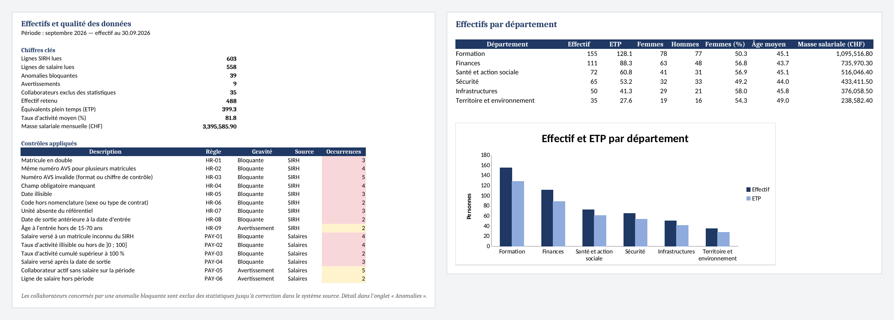

# headcount-data-quality

[](https://github.com/Zuzz001zu/headcount-data-quality/actions/workflows/ci.yml)

Monthly pipeline that takes the HR and payroll exports of an organisation, checks them
against a set of business rules, consolidates them in SQL and produces the headcount
statistics as an Excel report.

> **FR** — Consolidation et contrôle qualité des données RH et salaires, puis calcul des
> effectifs (effectif, ETP, répartition) avec rapport Excel. Python, pandas, SQL (SQLite),
> openpyxl. Données d'exemple entièrement fictives.



## The problem

Headcount figures are built from several systems that do not agree with each other:
the HR system (SIRH) knows who is employed, the payroll knows who was paid, and a
reference table maps units to departments. Before anything can be counted, the data
has to be cleaned and cross-checked: duplicated records, invalid AVS numbers, people
paid after they left, activity rates above 100 %, units that no longer exist...

This project automates that monthly work:

1. **Load** the three exports and normalise them (date formats, codes, Swiss number
   formats such as `6'450.50` or `80 %`).
2. **Check** 15 quality rules across and between the sources.
3. **Consolidate** the validated records in SQLite; employees with a blocking anomaly
   are left out until the source is corrected.
4. **Report**: headcount, FTE, payroll by department and unit, breakdown by contract
   and age, and the full list of anomalies to send back to the data owners.

## Quality rules

| Rule | Severity | Check |
|---|---|---|
| HR-01 | error | Employee ID appears more than once |
| HR-02 | error | Same AVS number for different employee IDs |
| HR-03 | error | Invalid AVS number (format or EAN-13 check digit) |
| HR-04 | error | Mandatory field missing |
| HR-05 | error | Date that cannot be read (e.g. `31.02.1985`) |
| HR-06 | error | Gender or contract type outside the code list |
| HR-07 | error | Unit not in the reference table |
| HR-08 | error | Exit date before hire date |
| HR-09 | warning | Age at hire outside 15-70 |
| PAY-01 | error | Salary paid to an ID unknown to the HR system |
| PAY-02 | error | Activity rate unreadable or outside ]0; 100] |
| PAY-03 | error | Total activity rate of one person above 100 % |
| PAY-04 | error | Salary paid after the exit date |
| PAY-05 | warning | Active employee without salary for the period |
| PAY-06 | warning | Payroll row from another period |

*Errors* exclude the employee from the statistics, *warnings* are reported but kept.

Rules are plain functions registered with a decorator, so adding one is a few lines:

```python
@rule("HR-07", ERROR, "Unité absente du référentiel")
def unknown_unit(sources: Sources) -> pd.DataFrame:
    e = sources.employees
    known = set(sources.units["unit_code"].dropna())
    return found(e[e["unit_code"].notna() & ~e["unit_code"].isin(known)], "unite", "unit_code")
```

## Headcount definition

An employee is counted when, on the **last day of the period**, they are under contract
(hired on or before that day, no exit date or an exit date on or after it) **and** have
at least one payroll line for the period. FTE is the sum of activity rates / 100;
several part-time contracts of the same person count as one person.

The SQL is kept in [`headcount/sql/`](headcount/sql) so it can be reviewed and reused
on its own.

## Quick start

```bash
python -m venv .venv
source .venv/bin/activate          # Windows: .venv\Scripts\activate
pip install -e ".[dev]"

headcount run --input data/sample --period 2026-09 --out reports
```

```text
Period 2026-09: 603 HR rows, 558 payroll rows
Anomalies: 39 blocking, 9 warnings -> 35 employees excluded
Headcount on 2026-09-30: 488 (399.3 FTE)
Report: reports/rapport_effectifs_2026-09.xlsx
Anomalies list: reports/anomalies_2026-09.csv
```

`--fail-on-errors` makes the command exit with code 1 when blocking anomalies are
found, which is useful in a scheduled job.

## Input files

| File | Content |
|---|---|
| `sirh_collaborateurs.csv` | HR export, `;` separated, one row per employee |
| `salaires_YYYY-MM.xlsx` | payroll for the month, one row per contract |
| `referentiel_unites.csv` | units and their department |

The column names are the French ones used in the exports (`matricule`, `no_avs`,
`date_entree`, `taux_activite`...). They are mapped to English names when loaded.

## Sample data

Real HR data cannot be published, so `data/sample/` is generated by
`headcount generate`: 600 fictional employees of a cantonal administration, with
realistic inconsistencies (mixed date formats, lower-case codes, AVS numbers without
dots) and a known number of anomalies of each type. The end-to-end test checks that
every rule finds exactly what the generator injected.

```bash
headcount generate --out data/sample --period 2026-09 --size 600 --seed 42
```

## Project structure

```text
headcount/
  load.py       read and normalise the exports
  avs.py        AVS number formatting and check digit
  rules.py      quality rules
  db.py         SQLite loading and queries
  sql/          headcount queries
  pipeline.py   load -> check -> consolidate -> aggregate
  report.py     Excel report (openpyxl)
  generate.py   fictional sample data
  cli.py        command line
tests/          unit tests per rule, SQL statistics, end-to-end
```

## Tests

```bash
pytest --cov=headcount
ruff check . && ruff format --check .
```

CI runs the linter, the tests on Python 3.11 to 3.13, then builds the report from the
sample data and publishes it as a workflow artifact.

## License

MIT
